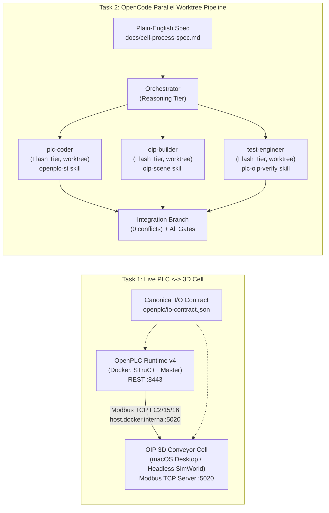

# SHRDC Assessment: OpenPLC v4 + OIP Conveyor Cell & OpenCode Multi-Agent Workflow

Reproducible macOS integration of **OpenPLC Runtime v4** (Docker, `STruC++`) driving a 3D **Open Industry Project (OIP)** Photo-Eye-Gated Conveyor **Cell** over Modbus TCP, paired with an executable **OpenCode** multi-agent workflow using progressive-disclosure skills, tiered Gemini models, and parallel `git worktree` isolation.

## Architecture at a Glance



## Key Documentation & Proof

- **Domain Language:** [GLOSSARY.md](GLOSSARY.md)
- **Architectural Decision Records:**
  - [ADR 0001 — OIP as Modbus TCP Server, OpenPLC as Master](docs/adr/0001-oip-modbus-server-openplc-master.md)
  - [ADR 0002 — Headless STruC++ Compilation & REST Deployment](docs/adr/0002-headless-strucpp-rest-deploy.md)
  - [ADR 0003 — Local macOS Desktop + Docker Demo Over Cloud VM](docs/adr/0003-local-desktop-docker-demo-over-cloud-vm.md)
- **Canonical I/O Contract & Process Spec:** [openplc/io-contract.json](openplc/io-contract.json), [docs/cell-process-spec.md](docs/cell-process-spec.md)
- **Captured Task 2 Execution Proof:** [docs/orchestration-proof.md](docs/orchestration-proof.md) ([JSON trace](docs/orchestration-proof.json))

## Prerequisites (macOS)

1. **Docker Desktop** running locally (for `openplc-runtime`).
2. **Node.js `>=24`** (verified on `v26.13.1`).
3. **Open Industry Project** cloned and built at `./Open-Industry-Project` (gitignored):
   ```bash
   git clone https://github.com/Open-Industry-Project/Open-Industry-Project.git
   npm --prefix Open-Industry-Project install
   npm --prefix Open-Industry-Project run build
   npm --prefix Open-Industry-Project/apps/desktop install
   ```
4. **STruC++ CLI** (`Autonomy-Logic/STruCpp` macOS release archive) unpacked at `.tools/strucpp/strucpp/strucpp` (gitignored) for local scan-cycle unit tests and Runtime v4.1+ `program.zip` packaging.
5. **OpenCode CLI** (`v2.4+`) with provider credentials stored outside git (`opencode auth list --standalone`). Local `.env`, `.env.*`, `.opencode/auth*`, `*.key`, and `*.pem` files are ignored via `.gitignore`.
6. **Start OpenPLC Runtime v4 (Docker):**
   ```bash
   docker compose up -d
   ```

## One-Command Headless Verification

Verify every seam (PLC scan-cycle unit tests, OIP strict scene/wiring/layout validators, OpenCode discovery & ignore rules, worktree orchestration tests, Modbus tracer, and live OpenPLC Docker ↔ OIP `SimWorld` 5-box Batch E2E) in one command:

```bash
npm run verify:all
```

| Command | Seam Verified |
| :--- | :--- |
| `npm run plc:test` | 7/7 `STruC++` scan-cycle tests (`tests/conveyor_cell.test.st`) |
| `npm run oip:validate` | 11/11 `I/O Contract` match, ST parity, and OIP strict project/ST/wiring/layout checks |
| `npm run test:opencode` | `opencode debug config` / `agents` discovery, progressive-disclosure skills, `.gitignore` rules |
| `npm run test:orchestrate` | NDJSON trace parsing, 3-way `git worktree` merge, and captured proof invariants |
| `npm run test:tracer` | Single-signal OpenPLC v4 ↔ OIP Modbus TCP tracer loop |
| `npm run test:e2e` | Live OpenPLC v4 Docker ↔ OIP `SimWorld` 5-box Batch + anti-touching spacing E2E |

## Live macOS OpenPLC + OIP Desktop 3D Demo Walkthrough

1. **Ensure OpenPLC Runtime v4 is running and deploy the Cell PLC program:**
   ```bash
   docker compose up -d
   npm run plc:deploy:cell
   ```
2. **Launch OIP Desktop natively against the Conveyor Cell project:**
   ```bash
   npm run oip:desktop
   ```
3. **Connect Modbus TCP inside OIP Desktop:**
   - Open the **External I/O** panel and start the Modbus TCP server on port `5020` (derived automatically from the 11 `I/O Contract` tags in `scenes/conveyor-cell/scene.json`).
   - OpenPLC (`host.docker.internal:5020`, `50ms` poll cycle) immediately begins driving the Cell.
4. **Operate the Cell in 3D:**
   - Press **Start (`Start_PB`, `%IX0.0`)** → green `Run_Light` turns on, conveyor runs, and `Spawner_Enable` pulses with a 5-second cooldown so boxes never spawn touching.
   - Watch each box reach the **Photo-Eye (`PhotoEye`, `%IX0.4`)** → `Box_Count` (`%QW0`) increments once, amber `Dwell_Light` illuminates for the 2-second **Inspection Dwell**, and spawning is inhibited until motion resumes.
   - After **5 boxes**, the **Batch** completes and the Cell halts automatically until **Reset (`Reset_Count_PB`, `%IX0.3`)** is pressed while stopped.
   - Toggle **E-Stop (`EStop`, `%IX0.2`)** → conveyor and spawner drop immediately, red `Fault_Light` illuminates, and releasing E-Stop never auto-restarts until a fresh Start press.

### Demo Recording Checklist

- [ ] Show `docker compose ps` (`openplc-runtime` up on `:8443`) and `npm run verify:all` passing all gates
- [ ] Show live 3D Cell in OIP Desktop: Start → spaced box dispensing → Photo-Eye 2s Inspection Dwell → 5-box Batch auto-halt → Reset while stopped → E-Stop safety interlock
- [ ] Show `opencode debug agents --standalone` (tiered Orchestrator vs. 3 skill-scoped workers)
- [ ] Show [docs/orchestration-proof.md](docs/orchestration-proof.md) (concurrent worktree overlap, 0 merge conflicts, per-agent skill scoping, tiered token/cost breakdown, and post-merge E2E pass)

## Task 2: OpenCode Multi-Agent Parallel `git worktree` Workflow

Inspect discovered agents and configuration sources:

```bash
opencode debug config --standalone
opencode debug agents --standalone
```

Execute the end-to-end orchestration pipeline from [docs/cell-process-spec.md](docs/cell-process-spec.md):

```bash
# Uses the configured agent models (google/gemini-4-neon + google/gemini-3.8-flash)
npm run orchestrate

# Or override models for Gemini API Free Tier accounts
npm run orchestrate -- \
  --orchestrator-model google/gemini-3-flash-preview \
  --worker-model google/gemini-flash-lite-latest
```

The pipeline runs the Orchestrator to produce a dispatch brief, launches `plc-coder` (`openplc-st`), `oip-builder` (`oip-scene`), and `test-engineer` (`plc-oip-verify`) concurrently in isolated OpenCode `--worktree` directories, merges their branches cleanly into an integration worktree, executes `plc:test`, `oip:validate`, and live `test:e2e` on the merged tree, cleans up temporary worktrees, and writes updated proof to [docs/orchestration-proof.md](docs/orchestration-proof.md) and [docs/orchestration-proof.json](docs/orchestration-proof.json).

## Repository Layout

- `openplc/` — Canonical `I/O Contract` (`io-contract.json`), IEC 61131-3 ST (`conveyor_cell.st`), and Modbus TCP master config (`conveyor_cell_modbus_master.json`)
- `scenes/conveyor-cell/` — Headless-authored OIP 3D Cell (`project.json`, `scene.json`, `plc/program.st`)
- `.opencode/skills/` — Progressive-disclosure domain skills (`openplc-st`, `oip-scene`, `plc-oip-verify`)
- `.opencode/agents/` — Tiered agent definitions (`orchestrator`, `plc-coder`, `oip-builder`, `test-engineer`)
- `scripts/` — Headless OpenPLC REST deployer (`openplc-deploy.mjs`), OIP Cell validator (`validate-oip-cell.mjs`), and parallel worktree orchestrator (`orchestrate-cell.mjs`)
- `tests/` — STruC++ scan-cycle unit tests, Modbus tracer, live E2E physics test, OpenCode config tests, and orchestration tests
- `docs/` — ADRs (`docs/adr/`), process spec (`cell-process-spec.md`), and captured orchestration proof (`orchestration-proof.{md,json}`)
