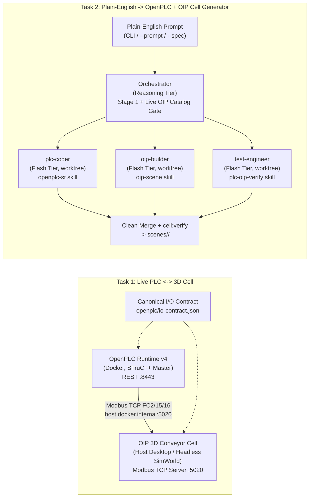

# SHRDC Assessment: OpenPLC v4 + OIP Conveyor Cell & OpenCode Multi-Agent Workflow

Cross-platform (**macOS, Linux, and Windows**) integration of **OpenPLC Runtime v4** (Docker, `STruC++`) driving a 3D **Open Industry Project (OIP)** Photo-Eye-Gated Conveyor **Cell** over Modbus TCP, paired with an executable **OpenCode** multi-agent workflow using progressive-disclosure skills, tiered Gemini models, and parallel `git worktree` isolation. *(Built and verified end-to-end on macOS; all scripts use pure-Node cross-platform helpers with zero external `zip` or POSIX shell dependencies.)*

## Architecture at a Glance



## Key Documentation & Proof

- **Domain Language:** [GLOSSARY.md](GLOSSARY.md)
- **Architectural Decision Records:**
  - [ADR 0001 — OIP as Modbus TCP Server, OpenPLC as Master](docs/adr/0001-oip-modbus-server-openplc-master.md)
  - [ADR 0002 — Headless STruC++ Compilation & REST Deployment](docs/adr/0002-headless-strucpp-rest-deploy.md)
  - [ADR 0003 — Local macOS Desktop + Docker Demo Over Cloud VM](docs/adr/0003-local-desktop-docker-demo-over-cloud-vm.md)
  - [ADR 0004 — Self-Contained Per-Cell Folders and Stage 1 Contract Seam](docs/adr/0004-self-contained-cells-and-stage1-contract-seam.md)
- **Canonical I/O Contract & Process Spec:** [openplc/io-contract.json](openplc/io-contract.json), [docs/cell-process-spec.md](docs/cell-process-spec.md)
- **Captured Task 2 Execution Proof:** [docs/orchestration-proof.md](docs/orchestration-proof.md) ([JSON trace](docs/orchestration-proof.json))

## Prerequisites (macOS, Linux, Windows)

1. **Docker** running locally (Docker Desktop on macOS/Windows, or Docker Engine on Linux). `docker-compose.yml` includes `extra_hosts: ["host.docker.internal:host-gateway"]` so Docker reaches the host's `:5020` Modbus TCP server on all platforms. On Linux, ensure your host firewall allows Docker bridge traffic to TCP port `5020`.
2. **Node.js `>=24`** (verified on `v26.13.1`).
3. **Open Industry Project** cloned and built at `./Open-Industry-Project` (gitignored):
   ```bash
   git clone https://github.com/Open-Industry-Project/Open-Industry-Project.git
   npm --prefix Open-Industry-Project install
   npm --prefix Open-Industry-Project run build
   npm --prefix Open-Industry-Project/apps/desktop install
   ```
4. **STruC++ CLI** unpacked at `.tools/strucpp/strucpp/` (gitignored) from the matching [`Autonomy-Logic/STruCpp`](https://github.com/Autonomy-Logic/STruCpp/releases) release archive (`strucpp-darwin-arm64.tar.gz`, `strucpp-linux-x64.tar.gz`, `strucpp-linux-arm64.tar.gz`, or `strucpp-win32-x64.zip`). Scripts automatically resolve `strucpp.exe` on Windows and `strucpp` on macOS/Linux, and package `program.zip` in pure Node without an external `zip` binary.
5. **OpenCode CLI** (`v2.4+`) with provider credentials stored outside git (`opencode auth list --standalone`). Local `.env`, `.env.*`, `.opencode/auth*`, `*.key`, and `*.pem` files are ignored via `.gitignore`.
6. **Start OpenPLC Runtime v4 (Docker):**
   ```bash
   docker compose up -d
   ```

## One-Command Headless Verification

Verify every seam (PLC scan-cycle unit tests, OIP strict scene/wiring/layout validators, OpenCode discovery & ignore rules, worktree orchestration tests, Modbus tracer, and live OpenPLC Docker ↔ OIP `SimWorld` 5-box Batch E2E) in one command:

```bash
npm run verify:all
```

| Command | Seam Verified |
| :--- | :--- |
| `npm run verify:offline` | Fast offline guardrail (`test:contract`, `plc:test`, `oip:validate`, `test:opencode`, `test:orchestrate`, `test:plc-bundle`, `test:harness`, `test:openplc-runtime`) |
| `npm run test:contract` | Canonical `I/O Contract` schema & conformance across ST, Modbus master, and OIP scene |
| `npm run plc:test` | 7/7 `STruC++` scan-cycle tests (`tests/conveyor_cell.test.st`) |
| `npm run oip:validate` | 11/11 `I/O Contract` match and OIP strict project/ST/wiring/layout checks |
| `npm run test:opencode` | `opencode debug config` / `agents` discovery, progressive-disclosure skills, `.gitignore` rules |
| `npm run test:orchestrate` | NDJSON trace parsing, state-machine/preflight guards, 3-way `git worktree` merge, and proof invariants |
| `npm run test:tracer` | Single-signal OpenPLC v4 ↔ OIP Modbus TCP tracer loop |
| `npm run test:e2e` | Live OpenPLC v4 Docker ↔ OIP `SimWorld` 5-box Batch + anti-touching spacing E2E |
| `npm run cell:verify -- <slug>` | Generic 3-gate verifier for any Cell (`checkConformance`, `STruC++ --test`, OIP strict validators + error-only `check-layout`) |
| `npm run cell:run -- <slug>` | Generic deployer + OIP Desktop launcher for any Cell (honors `OPENPLC_URL` and `OIP_MODBUS_HOST` env overrides) |
| `npm run hooks:install` | Enable local `.githooks/pre-commit` offline guardrail |

## Live OpenPLC + OIP Desktop 3D Demo Walkthrough

1. **Ensure OpenPLC Runtime v4 is running and deploy the Cell PLC program:**
   ```bash
   docker compose up -d
   npm run plc:deploy:cell
   ```
2. **Launch OIP Desktop natively against the Conveyor Cell project:**
   ```bash
   npm run oip:desktop
   ```
3. **Connect Modbus TCP inside OIP Desktop:**
   - Open the **External I/O** panel and start the Modbus TCP server on port `5020` (derived automatically from the 11 `I/O Contract` tags in `scenes/conveyor-cell/scene.json`).
   - OpenPLC (`host.docker.internal:5020`, `50ms` poll cycle) immediately begins driving the Cell.
4. **Operate the Cell in 3D:**
   - Press **Start (`Start_PB`, `%IX0.0`)** → green `Run_Light` turns on, conveyor runs, and `Spawner_Enable` pulses with a 5-second cooldown so boxes never spawn touching.
   - Watch each box reach the **Photo-Eye (`PhotoEye`, `%IX0.4`)** → `Box_Count` (`%QW0`) increments once, amber `Dwell_Light` illuminates for the 2-second **Inspection Dwell**, and spawning is inhibited until motion resumes.
   - After **5 boxes**, the **Batch** completes and the Cell halts automatically until **Reset (`Reset_Count_PB`, `%IX0.3`)** is pressed while stopped.
   - Toggle **E-Stop (`EStop`, `%IX0.2`)** → conveyor and spawner drop immediately, red `Fault_Light` illuminates, and releasing E-Stop never auto-restarts until a fresh Start press.

### Demo Recording Checklist

- [ ] Show `docker compose ps` (`openplc-runtime` up on `:8443`) and `npm run verify:all` passing all gates
- [ ] Show live 3D Cell in OIP Desktop: Start → spaced box dispensing → Photo-Eye 2s Inspection Dwell → 5-box Batch auto-halt → Reset while stopped → E-Stop safety interlock
- [ ] Show `opencode debug agents --standalone` (tiered Orchestrator vs. 3 skill-scoped workers)
- [ ] Show [docs/orchestration-proof.md](docs/orchestration-proof.md) (concurrent worktree overlap, 0 merge conflicts, per-agent skill scoping, tiered token/cost breakdown, and post-merge E2E pass)

## Task 2: Plain-English → OpenPLC + OIP Cell Generator

Describe any OIP-supported factory automation **Cell** in plain English and generate a self-contained, verified OpenPLC Structured Text program + OIP v4 3D simulation under `scenes/<slug>/`:

```bash
# Interactive terminal prompt (asks for plain-English description + optional slug)
npm run generate

# Non-interactive plain-English prompt (with live model preflight)
npm run generate -- --preflight --name color-sorter \
  --prompt "A roller conveyor cell with a box spawner, a color sensor, a diverter that pushes red (color code 1) boxes off into a side reject despawner while letting other boxes pass to an end despawner, Start/Stop push buttons, and a stack light."

# Generate from a Markdown process specification file
npm run generate -- --preflight --name conveyor-cell-gen --spec docs/cell-process-spec.md

# Cheap Stage-1-only dry run (synthesizes & validates I/O Contract + Modbus master only)
npm run generate -- --stage1-only --name dry-run-cell --prompt "A belt conveyor with start/stop buttons and a photo eye"
```

Optional flags: `--orchestrator-model <m>`, `--worker-model <m>`, `--preflight`, `--stage1-only`, `--deploy`, `--open`, `--verify-live`, `--force`. (`npm run orchestrate` is retained as an alias for `npm run generate`.)

### Verify & Run Any Generated Cell

```bash
# Run all 3 generic offline gates (I/O Contract conformance, STruC++ unit tests, OIP validators)
npm run cell:verify -- color-sorter

# Deploy to OpenPLC Runtime v4 (Docker) and launch OIP Desktop
npm run cell:run -- color-sorter

# EC2 / remote runtime overrides (optional)
OPENPLC_URL=https://<host>:8443 OIP_MODBUS_HOST=<oip-ip> npm run cell:run -- color-sorter --deploy-only
```

### How the Multi-Agent Pipeline Works

1. **Preflight (`--preflight`):** `npm run opencode:probe` probes live-callable tiered models (`google/gemini-4-neon` / `google/gemini-3.1-pro-preview` orchestrator vs. `google/gemini-3.8-flash` workers) with a 12s per-model timeout and fail-fast HTTP `429`/`503` retry guard.
2. **Stage 1 (Orchestrator + Live OIP Catalog Gate):** Reads OIP's live part catalog (`npm --prefix Open-Industry-Project run catalog -- --json`), synthesizes `scenes/<slug>/io-contract.json` (freezing `plc.functionBlockName`, `plc.programName`, signals, and `sceneRole`) and `scenes/<slug>/process-spec.md`, validates schema + catalog alignment (max 1 fast repair; fails fast on unsupported hardware), and deterministically derives `scenes/<slug>/plc/modbus_master.json`.
3. **Stage 2 (3 Parallel Isolated `git worktree` Workers):** Dispatches `plc-coder` (`openplc-st`), `oip-builder` (`oip-scene`), and `test-engineer` (`plc-oip-verify`) concurrently in isolated git worktrees with least-privilege skill scoping and zero Conveyor-Cell prompt leakage.
4. **Stage 3 & 4 (Clean Merge + Generic 3-Gate Verification + Persistence):** Merges all three worker branches with 0 conflicts, runs `cell:verify` (max 1 targeted orchestrator repair pass), persists the runnable Cell to `scenes/<slug>/` alongside `generation-report.{md,json}`, and cleans up all temporary worktrees/branches while protecting Task 1's `scenes/conveyor-cell/` from overwrite.

Inspect discovered agents and live-callable model tiers anytime:

```bash
opencode debug config --standalone
opencode debug agents --standalone
npm run opencode:probe
```

## Repository Layout

- `openplc/` — Canonical `I/O Contract` (`io-contract.json`), Modbus TCP master config (`conveyor_cell_modbus_master.json`), and tracer artifacts (`tracer_*`)
- `scenes/conveyor-cell/` — Headless-authored OIP 3D Cell (`project.json`, `scene.json`) and authoritative IEC 61131-3 ST program (`plc/program.st`)
- `.opencode/skills/` — Progressive-disclosure domain skills (`openplc-st`, `oip-scene`, `plc-oip-verify`)
- `.opencode/agents/` — Tiered agent definitions (`orchestrator`, `plc-coder`, `oip-builder`, `test-engineer`)
- `scripts/` — Headless OpenPLC REST deployer (`openplc-deploy.mjs`), OIP Cell validator (`validate-oip-cell.mjs`), and parallel worktree orchestrator (`orchestrate-cell.mjs`)
- `tests/` — STruC++ scan-cycle unit tests, Modbus tracer, live E2E physics test, OpenCode config tests, and orchestration tests
- `docs/` — ADRs (`docs/adr/`), process spec (`cell-process-spec.md`), and captured orchestration proof (`orchestration-proof.{md,json}`)
